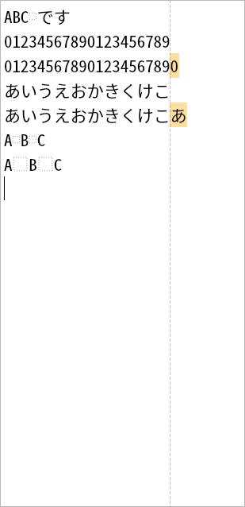

# PafoEdit (Web)

1行の表示幅を半角20列に固定した、プレーンテキスト専用のWebエディタ。サーバーを持たず、静的ファイルだけで動く。ファイル入出力は無く、クリップボードだけが外部との窓口。



## 挙動

- 同梱フォント **Noto Sans Mono CJK JP** のサブセット 16pt で固定表示（折り返しなし、横スクロール）。
- 行ごとに半角20列まで。超えた文字は警告色（琥珀）の背景で示す。制限は目安で、入力・貼り付けは制限しない。
- 20列の境界に破線のガイドを表示する。
- 空白はセル内に点線の□で表示する（半角 `U+0020` と全角 `U+3000`、セル幅に合わせた大きさ）。
- タブ文字は入力できない（`Tab`/`Shift+Tab` は何もしない）。貼り付けに含まれるタブは半角4空白、CRLF/CR は LF に正規化する。ドラッグ&ドロップは受け付けない（貼り付けを使う）。
- 保存・読込・メニュー・検索は無い。`Ctrl+C/V/X`、undo/redo、選択、IME はブラウザ標準の動作。

### 列の数え方

| 文字 | 列数 |
|---|---|
| 半角英数・記号、半角空白、幅の曖昧な文字（`①` `→` など） | 1 |
| 全角（`あ` `漢` `Ａ` `　` など、東アジア幅 W/F） | 2 |
| 結合文字・書式文字（`U+0301`、`U+200D` など） | 0 |
| 改行 | 数えない（行ごとにリセット） |

全角文字が20列目に食い込む場合は、その文字全体を超過として着色する。

## ローカルで動かす

```sh
python3 -m http.server 8123 --directory web
```

http://127.0.0.1:8123/ を開く。フォントは `@font-face` で読むため、`file://` ではなく HTTP で配信する。

## Cloudflare Workers（Git 連携 / Static Assets）

Pages タブが無いダッシュボードでは **Workers Static Assets** で配信する。`wrangler.jsonc` が `web/` をアセットディレクトリとして指定している。

1. `main` と `desktop` を GitHub に push する。
2. Cloudflare ダッシュボード → **Workers & Pages** → **Create application** → **Import a repository**（Git 連携）。
3. リポジトリ `tubame0505/PafoEdit` を選び、次を設定する:
   - Application / Worker name: `pafoedit`（`wrangler.jsonc` の `name` と一致させる）
   - Production branch: `main`
   - Build command: `exit 0`
   - Deploy command: `npx wrangler deploy`
   - Preview command / Non-production branch deploy command: `npx wrangler versions upload`（プレビューを使わないなら空）
   - Root directory: 空欄
4. **Deploy**。以後 `main` への push で自動デプロイされる。

- 公開 URL は `https://pafoedit.<account>.workers.dev/`（Worker 名とアカウントの workers.dev サブドメイン）。
- Worker スクリプトは持たず、`assets.directory = ./web` の静的アセットのみ。
- `web/_headers` でフォントを1年キャッシュする。
- 制限は Pages と同じ 25 MiB/ファイル、20,000ファイル。最大の資産はフォント 4.06 MiB。
- 非 production ブランチのビルドは有効にしない（`desktop` ブランチには `web/` が無いため）。
- Worker 名を変える場合は `wrangler.jsonc` の `name` も変える。

## 対応ブラウザ

- 最新の Chromium / Firefox / Safari。
- 日本語 IME の変換はブラウザ/OS の `textarea` 実装に依存する（自動テスト対象外、手動確認）。
- クリップボードは `copy`/`paste` イベント経由で、非同期 Clipboard API の権限を必要としない。

## フォント

- `web/fonts/NotoSansMonoJP-subset.ttf`（ASCII + JIS X 0208 + 半角カタカナ、4.06 MiB）。
- Noto Sans Mono CJK JP のサブセット。SIL Open Font License 1.1。全文は `web/fonts/LICENSE-NotoSansMonoJP.txt`。
- 起動時に canvas で「全角幅 ≒ 半角幅×2」を検証し、崩れていれば console に警告する。フォントを替えるときも 1:2 を満たすものを選ぶ。
- JIS X 0208 外の文字は OS のフォントへフォールバックし、その行だけ列幅が崩れる。

## デスクトップ版

Python / PySide6 実装は `desktop` ブランチにある（`git push -u origin desktop` で GitHub にも反映する）。
